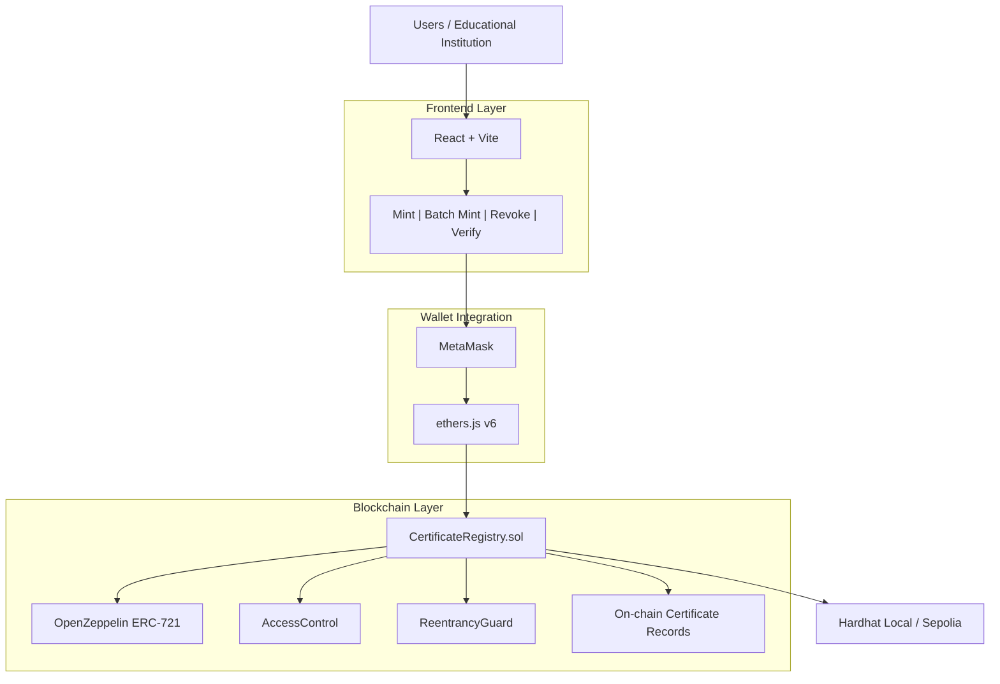
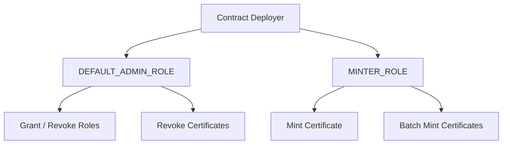
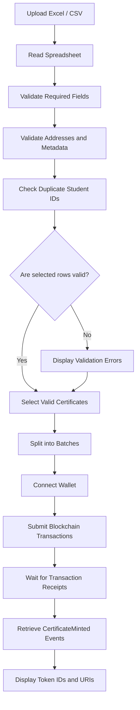
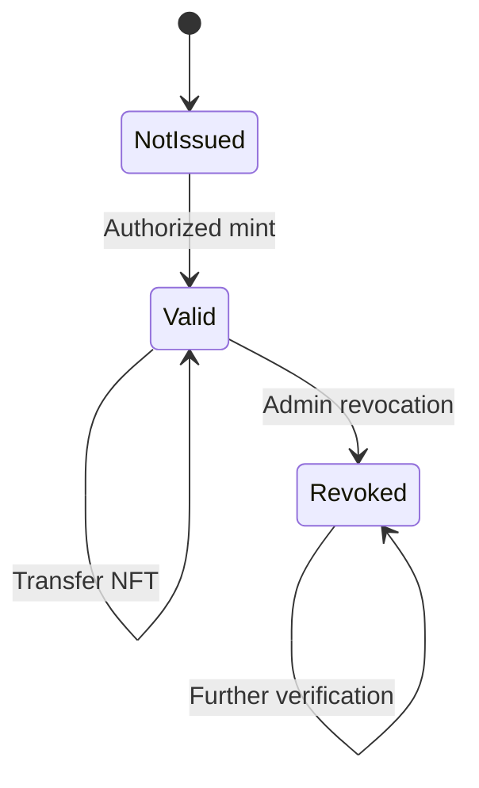

# Academic Certificate DApp

### Blockchain-Based Academic Certificate Issuance and Verification Platform


---

## 1. Overview

**Academic Certificate DApp** is a decentralized application designed to issue, manage, and verify academic certificates using blockchain technology.

The platform transforms traditional academic certificates into unique **ERC-721 Non-Fungible Tokens (NFTs)**. Each certificate is represented by a unique token with associated metadata, providing a transparent and verifiable record of academic achievements.

Educational institutions can issue certificates individually or in batches, manage access permissions, revoke certificates when necessary, and allow users to verify certificate information directly through the blockchain.

The project combines a Solidity smart contract with a React-based frontend and MetaMask wallet integration.

### Main Objectives

- Implement the ERC-721 standard for academic certificates.
- Ensure that each certificate has a unique token ID.
- Manage institutional permissions using OpenZeppelin AccessControl.
- Support individual and batch certificate issuance.
- Provide certificate revocation functionality.
- Allow public certificate verification.
- Apply security best practices and automated testing.
- Perform static security analysis using Slither.

---

## 2. System Architecture

The application follows a decentralized architecture composed of four main layers:

1. **User Interface:** React and Vite frontend.
2. **Wallet Integration:** MetaMask and ethers.js.
3. **Smart Contract:** Solidity and OpenZeppelin ERC-721.
4. **Blockchain Network:** Hardhat local network or Ethereum Sepolia testnet.

### Architecture Diagram



### Component Responsibilities

| Component | Responsibility |
|---|---|
| React + Vite | User interface and application logic |
| MetaMask | Wallet connection and transaction approval |
| ethers.js | Smart contract interaction |
| CertificateRegistry.sol | Certificate lifecycle management |
| ERC721URIStorage | NFT ownership and metadata URI |
| AccessControl | Role-based authorization |
| ReentrancyGuard | Protection against reentrant calls |
| Hardhat | Development, deployment and testing |
| Slither | Static security analysis |

---

## 3. Technology Stack

### Smart Contract Development

- **Solidity 0.8.34:** Smart contract programming language.
- **OpenZeppelin Contracts 5.6.1:** Audited and reusable smart contract implementations.
- **ERC-721:** Non-fungible token standard.
- **ERC721URIStorage:** Token metadata URI management.
- **AccessControl:** Role-based permissions.
- **ReentrancyGuard:** Reentrancy protection.

### Blockchain Development

- **Hardhat 3.22:** Smart contract compilation, deployment and testing.
- **Ethereum:** Blockchain environment.
- **Hardhat Local Network:** Local blockchain for development.
- **Sepolia:** Target Ethereum testnet.

### Frontend

- **React:** Component-based user interface.
- **Vite:** Frontend development server.
- **TypeScript:** Type-safe application development.
- **ethers.js v6:** Ethereum interaction library.
- **MetaMask:** Wallet connection.
- **xlsx:** Excel and spreadsheet file processing.

### Security and Testing

- **Hardhat Tests:** Automated smart contract testing.
- **Slither 0.11.6:** Static security analysis.
- **OpenZeppelin:** Standardized security components.

---

## 4. ERC-721 Implementation

The project uses ERC-721 because each academic certificate represents a unique achievement belonging to a specific student.

Unlike fungible tokens, each NFT has its own token ID and metadata.

### Why ERC-721?

Each certificate must be:

- Unique.
- Associated with a specific recipient.
- Identifiable through its token ID.
- Accessible through its metadata URI.
- Verifiable independently.

The contract inherits from:

```solidity
ERC721URIStorage
AccessControl
ReentrancyGuard
```

The ERC-721 token collection is initialized as:

```solidity
ERC721("Academic Certificate", "ACERT")
```

### Certificate Structure

Each certificate stores the following information:

```solidity
struct Certificate {
    string studentName;
    string studentId;
    string diplomaTitle;
    string issueDate;
    string grade;
    address recipient;
    bool revoked;
}
```

Each certificate also has:

- A unique `tokenId`.
- A metadata URI accessible through `tokenURI(tokenId)`.
- An owner represented by an Ethereum address.
- A revocation status.

### Certificate Metadata

The metadata URI points to an external JSON document describing the NFT.

Example:

```json
{
  "name": "Academic Certificate - Amine El Fassi",
  "description": "Academic achievement certificate",
  "attributes": [
    {
      "trait_type": "Student ID",
      "value": "IDIA001"
    },
    {
      "trait_type": "Diploma",
      "value": "Master in Data Engineering and AI"
    },
    {
      "trait_type": "Grade",
      "value": "16.5"
    }
  ]
}
```

**Note:** The example URI used during local testing (`https://example.com/...`) is illustrative. It does not represent actual hosted metadata. A production deployment should use persistent metadata storage such as IPFS.

---

## 5. Access Control and Security Roles

The smart contract uses OpenZeppelin's `AccessControl` to manage permissions.

Two main roles are implemented.

| Role | Permissions |
|---|---|
| DEFAULT_ADMIN_ROLE | Grant and revoke roles, revoke certificates |
| MINTER_ROLE | Issue individual and batch certificates |

The contract deployer receives both roles during deployment.

### Role Management Diagram



### Access Control Implementation

The minter role is defined as:

```solidity
bytes32 public constant MINTER_ROLE =
    keccak256("MINTER_ROLE");
```

Certificate issuance requires:

```solidity
onlyRole(MINTER_ROLE)
```

Certificate revocation requires:

```solidity
onlyRole(DEFAULT_ADMIN_ROLE)
```

Unauthorized accounts cannot execute these protected operations.

---

## 6. Smart Contract Functionalities

The `CertificateRegistry.sol` contract implements the complete certificate lifecycle.

### 6.1 Individual Certificate Minting

Function:

```solidity
mintCertificate(...)
```

This function:

1. Checks whether the caller has MINTER_ROLE.
2. Validates the certificate information.
3. Checks that the student ID has not already been used.
4. Creates the certificate record.
5. Assigns a unique token ID.
6. Mints the ERC-721 token.
7. Associates the metadata URI.
8. Emits `CertificateMinted`.

### 6.2 Batch Certificate Minting

Function:

```solidity
batchMintCertificates(...)
```

The function allows authorized institutions to issue multiple certificates in one transaction.

The implementation:

- Accepts arrays containing recipients and certificate information.
- Checks that all arrays have identical lengths.
- Rejects empty batches.
- Validates every certificate.
- Rejects duplicate student IDs.
- Creates individual NFTs for all valid entries.

The frontend also supports importing certificate information from Excel and CSV files.

### Batch Minting Workflow



### 6.3 Certificate Revocation

Function:

```solidity
revokeCertificate(uint256 tokenId)
```

Only the administrator can revoke a certificate.

Revocation:

- Checks whether the certificate exists.
- Prevents repeated revocation.
- Updates the certificate's `revoked` flag.
- Emits `CertificateRevoked`.

**Important design decision:** Revocation does not burn the NFT. The certificate record and token remain available, but its status indicates that it is no longer valid.

The student ID also remains reserved after revocation to prevent issuing another certificate using the same ID.

### 6.4 Certificate Verification

Function:

```solidity
getCertificate(uint256 tokenId)
```

This function retrieves the certificate information stored on-chain.

The frontend allows users to verify certificate information and inspect its status.

### 6.5 Token Metadata Retrieval

Function:

```solidity
tokenURI(uint256 tokenId)
```

Returns the metadata URI associated with the NFT.

---

## 7. Certificate Lifecycle

The following diagram summarizes the lifecycle of an academic certificate.



A certificate starts as unissued, becomes valid after successful minting, and can subsequently be revoked by an administrator.

Revoked certificates are not burned or deleted.

---

## 8. Frontend Features

The React frontend provides an interface for interacting with the smart contract.

### Wallet Connection

Users can connect their MetaMask wallet.

The frontend handles:

- Wallet connection.
- Account detection.
- Network validation.
- Transaction signing.
- Wallet disconnection from the application.

### Individual Minting

The interface allows authorized users to enter:

- Student name.
- Student ID.
- Diploma title.
- Issue date.
- Grade.
- Recipient address.
- Metadata URI.

After successful issuance, the frontend displays:

- Token ID.
- Token URI.
- Transaction hash.

### Batch Minting

Users can upload Excel or CSV files containing multiple certificate records.

The frontend provides:

- Spreadsheet parsing.
- Required-field validation.
- Ethereum address validation.
- Date and grade validation.
- Duplicate ID detection.
- Blockchain duplicate checks.
- Row selection.
- Batch processing.
- Transaction progress and results.

### Certificate Revocation

Administrators can revoke an existing certificate by specifying its token ID.

### Certificate Verification

Users can retrieve certificate information and check its revocation status.

---

## 9. Project Structure

```text
Academic-Certificate-DApp/
│
├── contracts/
│   └── CertificateRegistry.sol
│
├── test/
│   └── CertificateRegistry.ts
│
├── scripts/
│   └── deploy.ts
│
├── frontend/
│   ├── src/
│   │   ├── components/
│   │   │   ├── BatchMintCertificates.tsx
│   │   │   ├── MintCertificate.tsx
│   │   │   ├── RevokeCertificate.tsx
│   │   │   ├── VerifyCertificate.tsx
│   │   │   └── ConnectWallet.tsx
│   │   │
│   │   ├── contracts/
│   │   │   └── CertificateRegistry.json
│   │   │
│   │   └── services/
│   │       └── contract.ts
│   │
│   └── package.json
│
├── hardhat.config.ts
├── package.json
├── AUDIT_REPORT.md
└── README.md
```

*The structure above highlights the main project files. Additional configuration, styles and application files may also be present.*

---

## 10. Installation and Configuration

### Prerequisites

Install the following tools:

- Node.js and npm.
- Python 3.12 or compatible version (for Slither).
- MetaMask browser extension.
- Git.

### Step 1: Clone the Repository

```bash
git clone <YOUR_GITHUB_REPOSITORY_URL>
cd Academic-Certificate-DApp
```

### Step 2: Install Smart Contract Dependencies

```bash
npm install
```

### Step 3: Compile the Smart Contract

```bash
npx hardhat compile
```

### Step 4: Run Automated Tests

```bash
npx hardhat test
```

### Step 5: Start the Local Blockchain

Open a terminal:

```bash
npx hardhat node
```

Keep this terminal running.

### Step 6: Deploy the Contract Locally

Open another terminal at the project root:

```bash
npx hardhat run scripts/deploy.ts --network localhost
```

Copy the deployed contract address.

### Step 7: Configure the Frontend

Open:

```text
frontend/src/services/contract.ts
```

Update the contract address and expected chain ID according to the selected network.

For the local Hardhat network:

```typescript
const CONTRACT_ADDRESS = "YOUR_LOCAL_CONTRACT_ADDRESS";
const EXPECTED_CHAIN_ID = 31337n;
```

### Step 8: Start the Frontend

```bash
cd frontend
npm install
npm run dev
```

Open the local URL displayed by Vite in your browser.

### Step 9: Configure MetaMask

For local testing:

1. Add the Hardhat Local network to MetaMask.
2. Set the RPC URL to `http://127.0.0.1:8545`.
3. Set the Chain ID to `31337`.
4. Import a test account from the Hardhat node output.
5. Connect MetaMask to the application.

**Security warning:** Hardhat private keys are for local testing only. Never import them into a real wallet or use them on mainnet.

---

## 11. Testing and Results

The project uses Hardhat to test the smart contract.

Command:

```bash
npx hardhat test
```

### Test Results

**17 tests passing**

| Test Category | Tests |
|---|---|
| Deployment | 2 |
| Individual Minting | 5 |
| Access Control | 3 |
| Batch Minting | 4 |
| Revocation | 3 |
| **Total** | **17** |

### Tested Scenarios

- Correct role assignment during deployment.
- ERC-721 interface support.
- Successful certificate minting.
- Metadata retrieval.
- Duplicate student ID rejection.
- Invalid recipient rejection.
- Empty URI rejection.
- Event emission.
- Unauthorized minting prevention.
- Unauthorized revocation prevention.
- Role administration restrictions.
- Successful batch minting.
- Empty batch rejection.
- Duplicate IDs within a batch.
- Mismatched array length rejection.
- Successful certificate revocation.
- Prevention of repeated revocation.
- Prevention of student ID reuse after revocation.

All 17 tests passed successfully in the latest recorded test execution.

---

## 12. Security Audit

Static security analysis was performed using **Slither 0.11.6**.

### Audit Command

```bash
slither . --exclude-dependencies
```

### Audit Results

```text
Contracts analyzed: 24
Detectors used: 102
Findings reported: 3
```

### Findings

| Detector | Analysis |
|---|---|
| reentrancy-benign | `_safeMint()` performs an external receiver callback before `_setTokenURI()`. |
| pragma | Different Solidity version constraints are used across imported dependencies. |
| costly-loop | The batch mint loop increments the token ID counter. |

### Implemented Security Measures

- Role-based access control.
- ReentrancyGuard on mint operations.
- Input validation.
- Duplicate student ID prevention.
- Zero-address rejection.
- Batch array length validation.
- Explicit certificate revocation.
- Solidity 0.8.x checked arithmetic.
- Automated security-related tests.

### Audit Limitations

The Slither findings were reviewed, but no dedicated malicious ERC-721 receiver simulation was performed.

No professional third-party audit, formal verification, or dedicated gas benchmark was performed.

For detailed information, see [`AUDIT_REPORT.md`](./AUDIT_REPORT.md).

---

## 13. Screenshots and Demonstrations

Screenshots and demonstration videos can be added to the repository to illustrate the application.

Suggested organization:

```text
docs/
│
├── screenshots/
│   ├── 01-wallet-connection.png
│   ├── 02-individual-mint.png
│   ├── 03-mint-result.png
│   ├── 04-batch-import.png
│   ├── 05-batch-validation.png
│   ├── 06-batch-mint-result.png
│   ├── 07-certificate-revocation.png
│   ├── 08-certificate-verification.png
│   └── 09-hardhat-tests.png
│
└── videos/
    ├── individual-mint-demo.mp4
    ├── batch-mint-demo.mp4
    └── certificate-verification-demo.mp4
```

### Application Screenshots

Add your screenshots below as they become available.

#### Wallet Connection


#### Individual Certificate Issuance


#### Batch Certificate Issuance


#### Certificate Revocation


#### Certificate Verification


*Replace these image paths with the actual screenshots saved in the repository.*

---

## 14. Deployment

### Local Deployment

The contract has been tested using the Hardhat local blockchain.

The local network uses:

```text
Network: Hardhat Local
Chain ID: 31337
RPC URL: http://127.0.0.1:8545
```

### Sepolia Testnet

The project targets the Ethereum Sepolia testnet for public test deployment.

**Deployment status:** Pending.

Complete this section after deployment:

| Information | Value |
|---|---|
| Network | Sepolia |
| Chain ID | 11155111 |
| Contract Address | To be added |
| Deployment Transaction | To be added |
| Deployer Address | To be added |

After deployment, update the frontend contract address and expected chain ID.

Useful resources:

- [Sepolia Etherscan](https://sepolia.etherscan.io/)
- [Ethereum Sepolia Documentation](https://ethereum.org/en/developers/docs/networks/#sepolia)

---

## 15. Future Improvements

Potential future improvements include:

- Store certificate metadata and images on IPFS.
- Generate QR codes for public certificate verification.
- Add a dedicated certificate verification page.
- Implement more extensive adversarial security tests.
- Add gas optimization for large batch operations.
- Support ERC-1155 for institutions managing multiple diploma categories.
- Add certificate export and printable PDF functionality.
- Deploy the application to a public hosting platform.

---

## 16. Author and Project Information

**Author:** OUARAGHOUANE Nour El Houda
**Project:** Academic Certificate DApp  
**Standard:** ERC-721  
**Framework:** Hardhat + OpenZeppelin + React + Vite

Developed as part of an academic assignment focused on ERC standards, smart contract development, and security auditing.

---

## License

This project is distributed under Nourmiyy03 License unless otherwise specified 😎.

